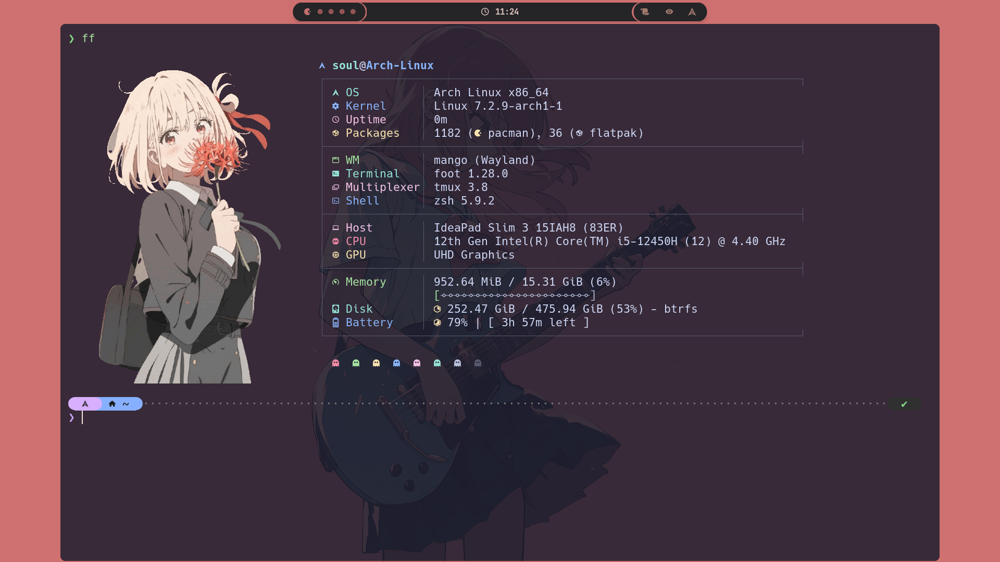

<div align="center">

# 🥭 mangobar

**An ultra-lightweight, blazing-fast Wayland status bar featuring floating capsules, calligraphic curves, ambient drop shadows, and rich dynamic styling.**

[](https://en.wikipedia.org/wiki/C99)
[](https://mesonbuild.com)
[](https://wayland.freedesktop.org/)
[](LICENSE)
[](https://github.com/SoulByte07/My-MangoWM.git)

<br/>

<a href="https://github.com/SoulByte07/My-MangoWM.git">
  
</a>

<br/>
<br/>

> 💡 **Looking for a ready-to-rock desktop setup?**  
> Check out **[SoulByte07 / My-MangoWM](https://github.com/SoulByte07/My-MangoWM.git)** for full configuration files, themes, animations, custom scripts, and a tailored MangoWM environment.

</div>

---

## 🌟 Overview & Fork Features

**mangobar** is a lightweight, zero-bloat Wayland status bar engineered in pure C with `wlr-layer-shell`, Cairo, Pango, and Pixman. Built for speed and minimal memory footprint, this fork introduces advanced modern styling capabilities, floating capsule geometries, and visual polish:

- 🎈 **Floating Centered Capsule Mode**: Define custom bar widths in pixels or percentages (e.g. `"width": "85%"` or `"width": 1400`). Automatically centers on your output with proper top/bottom exclusive-zone margin handling.
- 🌘 **Native Cairo Ambient Drop Shadows**: Hardware-accelerated, configurable ambient shadows using CSS `box-shadow` properties (e.g. `box-shadow: 0 4px 14px #00000066;`).
- ✒️ **Tapered "C" Calligraphic Endcaps**: Dynamic dual-width borders (`border-width: 1px 3px;`) that seamlessly transition from razor-thin top/bottom lines to bold, elegant crescent curves on capsule edges.
- 🫧 **Unified Capsule Clustering**: Group right-side modules (`#modules-right`) or workspace tags (`#tags` / `#workspaces`) inside a cohesive bubble container instead of fragmented buttons.
- 👾 **Dynamic State Icons**: Configure custom icons for workspaces/tags based on state (`active`, `occupied`, `empty`, `urgent`) — perfect for Pacman, dots, ghost, or roman numeral setups.
- 🔀 **Layout Glyph Mapping**: Map MangoWM layout symbols (`tile`, `scroller`, `monocle`, etc.) to custom icons via JSON configuration.
- ⚡ **Pure Native Performance**: No GTK, Qt, or web runtime overhead. Just pure C, Pixman, Pango, and Cairo for sub-millisecond drawing and featherweight resource usage.

---

## 📦 Installation

### 1. Dependencies

#### Arch Linux
```bash
sudo pacman -S --needed meson ninja cjson wayland wayland-protocols \
  fcft tllist pixman cairo pango libpulse systemd-libs gdk-pixbuf2 pkg-config
```

#### Debian / Ubuntu
```bash
sudo apt install meson ninja-build libcjson-dev libwayland-dev \
  wayland-protocols libfcft-dev libpixman-1-dev libcairo2-dev \
  libpango1.0-dev libpulse-dev libtllist-dev libsystemd-dev libgdk-pixbuf-2.0-dev \
  pkg-config
```

#### Fedora
```bash
sudo dnf install meson ninja-build cjson-devel wayland-devel \
  wayland-protocols-devel fcft-devel pixman-devel cairo-devel \
  pango-devel pulseaudio-libs-devel systemd-devel gdk-pixbuf2-devel \
  pkgconf-pkg-config
```

#### Void Linux
```bash
sudo xbps-install -S meson ninja cJSON-devel wayland-devel \
  wayland-protocols fcft-devel pixman-devel cairo-devel \
  pango-devel libpulse-devel elogind-devel gdk-pixbuf-devel pkg-config
```

*Runtime note: `pamixer` and `brightnessctl` are only needed if your scroll/click handlers invoke them.*

---

### 2. Build from Source

```bash
git clone https://github.com/SoulByte07/mangobar.git
cd mangobar
meson setup build -Dprefix=/usr
ninja -C build
sudo ninja -C build install
```

---

### 3. Nix / NixOS / Home Manager

#### Build package locally
```bash
nix build .#mangobar
./result/bin/mangobar
```

#### Home Manager Module
Import the flake module into your home-manager configuration:

```nix
{
  imports = [ inputs.mangobar.homeManagerModules.default ];

  services.mangobar = {
    enable = true;
    systemdTarget = "mango.target"; # or graphical-session.target
    # Provide an existing config or define attributes directly:
    configFile = ./config/mangobar/config.jsonc;
  };
}
```

---

## 🚀 Quick Start & Usage

Start **mangobar** with default configuration paths (`~/.config/mangobar/config.jsonc` and `~/.config/mangobar/style.css`):

```bash
mangobar
```

### CLI Flags
```text
Usage: mangobar [options]

Options:
  -h            Show this help message and exit.
  -v            Show version information and exit.
  -c <path>     Path to custom configuration file (JSONC).
  -s <path>     Path to custom CSS stylesheet.
```

---

## ⚙️ Configuration (`config.jsonc`)

Place your configuration at `~/.config/mangobar/config.jsonc` (or pass `-c /path/to/config.jsonc`).

### Example Configuration

```jsonc
{
    // Layer-shell layer: "top", "bottom", "overlay", "background"
    "layer": "top",
    
    // Bar height in pixels
    "height": 30,
    
    // Floating bar width: set fixed pixels (e.g. 1400) or percentage (e.g. "85%")
    // Leave unset or 0 for full-width edge-to-edge bar
    "width": "85%",
    
    "buffer-scale": 1,
    "sys-interval": 2,

    // Module placement arrays
    "modules-left": [
        "workspaces",
        "layout",
        "window"
    ],
    "modules-center": [],
    "modules-right": [
        "network",
        "cpu",
        "memory",
        "pulseaudio",
        "backlight",
        "battery",
        "clock#date",
        "clock#time",
        "tray",
        "custom/power"
    ],

    // --- Workspaces / Tags ---
    "workspaces": {
        "hide-empty": false,
        "format-icons": {
            "active": "󰮯",
            "occupied": "󰊠",
            "empty": "",
            "urgent": "󰊠",
            "default": ""
        },
        "on-click": "activate",
        "on-click-right": "toggle"
    },

    // --- Layout ---
    "layout": {
        "format": "{}",
        "format-icons": {
            "tile": "[]=",
            "scroller": "[S]",
            "monocle": "[M]"
        }
    },

    // --- Active Window Title ---
    "window": {
        "format": "{}"
    },

    // --- Network Module ---
    "network": {
        "format": "{icon} {ifname}",
        "format-wifi": "{signal} {ssid}",
        "format-disconnected": "󰖪 Disconnected",
        "icon-wifi": "󰖩",
        "icon-ethernet": "󰈀",
        "icon-disconnected": "󰖪",
        "signal-icons": ["󰤯", "󰤟", "󰤢", "󰤥", "󰤨"]
    },

    // --- Hardware Monitors ---
    "cpu": {
        "format": " {load}%",
        "interval": 2
    },
    "memory": {
        "format": " {}%",
        "interval": 2
    },

    // --- Audio (PulseAudio / PipeWire) ---
    "pulseaudio": {
        "format": "{icon} {volume}%",
        "format-muted": "󰝟 Muted",
        "icons": ["󰝟", "󰕿", "󰕾"],
        "on-click": "pamixer -t",
        "on-scroll-up": "pamixer -i 2",
        "on-scroll-down": "pamixer -d 2"
    },

    // --- Display Brightness ---
    "backlight": {
        "format": "{icon} {percent}%",
        "icons": ["󰃚", "󰃛", "󰃜", "󰃝", "󰃞", "󰃟"],
        "on-scroll-up": "brightnessctl set 2%+",
        "on-scroll-down": "brightnessctl set 2%-"
    },

    // --- Battery Module ---
    "battery": {
        "format": "{icon} {percent}%",
        "icons": ["󰂎", "󰁺", "󰁻", "󰁼", "󰁽", "󰁾", "󰁿", "󰂀", "󰂁", "󰂂", "󰁹"]
    },

    // --- Clocks ---
    "clock#date": {
        "format": " {:L%b %d · %a}"
    },
    "clock#time": {
        "format": " {:L%H:%M}"
    },

    // --- System Tray ---
    "tray": {
        "icon-size": 20,
        "spacing": 8
    },

    // --- Custom Action Module ---
    "custom/power": {
        "format": "󰣇",
        "on-click": "wlogout",
        "on-click-right": "swaync-client -t -sw"
    }
}
```

---

## 🎨 Styling Reference (`style.css`)

**mangobar** uses an ultra-fast CSS parser supporting high-end styling features. Save your stylesheet at `~/.config/mangobar/style.css` (or specify via `-s`).

### Supported Selectors
- `#bar`: Outer bar container.
- `#tags` / `#workspaces`: Container capsule for workspace tags.
- `#tags.active`, `#tags.occupied`, `#tags.empty`, `#tags.urgent`: Individual workspace states.
- `#layout`: Layout indicator pill.
- `#title`: Focused window title.
- `#modules-right`: Right-side module cluster bubble.
- Module IDs: `#clock`, `#clock.date`, `#cpu`, `#mem`, `#brightness`, `#volume`, `#network`, `#battery`, `#tray`.
- Custom modules: `#custom-<name>` (e.g. `custom/power` -> `#custom-power`).
- Popup context menu: `menu`, `menuitem`, `menuitem:hover`.

### Special Fork Styling Properties

| CSS Property | Syntax / Example | Description |
| :--- | :--- | :--- |
| `box-shadow` | `0 4px 12px 0px rgba(0,0,0,0.5)` | Native Cairo drop shadow with X/Y offset, blur radius, and color. |
| `border-width` | `1px 3px` | **Tapered "C" calligraphic border**: first value sets thin top/bottom stroke; second value sets crescent apex thickness. |
| `border-radius` | `100px` | Set exact corner radius or large value for pills. |
| `background-color`| `#1b1a1a` / `transparent` / `none` | Supports 6/8-digit hex or transparent keywords. |
| `margin-bottom` | `8px` | Adds bottom margin offset with exclusive-zone compensation. |

### Example Stylesheet

```css
/* Global font configuration */
* {
    font-family: "Maple Mono NF CN", monospace;
    font-size: 16px;
    font-weight: bold;
    color: #ebdbb2;
}

/* Outer floating capsule bar with ambient drop shadow */
#bar {
    background-color: rgba(32, 27, 20, 0.85);
    border-color: #83a598;
    border-width: 1px 3px;     /* Calligraphic endcap tapering */
    border-radius: 100px;
    margin: 8px 12px;
    box-shadow: 0 4px 14px rgba(0, 0, 0, 0.55);
}

/* Unified tag capsule */
#tags {
    padding: 0px 8px;
    margin: 3px 4px;
}

#tags.active {
    background-color: #83a598;
    color: #1b1a1a;
    border-radius: 100px;
}

#tags.occupied {
    color: #ebdbb2;
}

#tags.empty {
    color: #504945;
}

/* Layout module */
#layout {
    background-color: #bd788a;
    color: #111111;
    border-radius: 100px;
    padding: 0px 10px;
    margin: 3px 4px;
}

/* Unified bubble cluster for right-side modules */
#modules-right {
    background-color: #2b2827;
    border-color: #665c54;
    border-width: 1px 2px;
    border-radius: 100px;
    padding: 0px 12px;
    margin: 3px 6px;
}

/* Module colors */
#cpu {
    color: #c4b595;
}

#mem {
    color: #83a598;
}

#volume {
    color: #d19e27;
}

#battery {
    color: #b8bb26;
}

#custom-power {
    color: #fb4934;
    padding: 0px 8px;
}
```

---

## 🤝 The MangoWM Ecosystem

Complement your bar with the full user experience at [SoulByte07 / My-MangoWM](https://github.com/SoulByte07/My-MangoWM.git):

```text
My-MangoWM/
├── .config/
│   ├── mango/           # MangoWM compositor settings & layout rules
│   ├── mangobar/        # Floating capsule configs & themes
│   ├── foot/ / kitty/   # Color-matched terminal emulators
│   └── wlogout/         # Complementary power menu & lockscreen
```

---

## 📜 License

This project is licensed under the **GNU General Public License v3.0 (GPL-3.0)** — see the [LICENSE](LICENSE) file for details.
